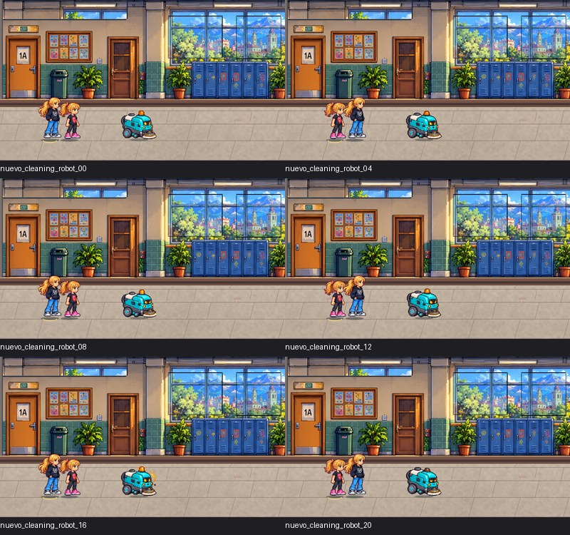
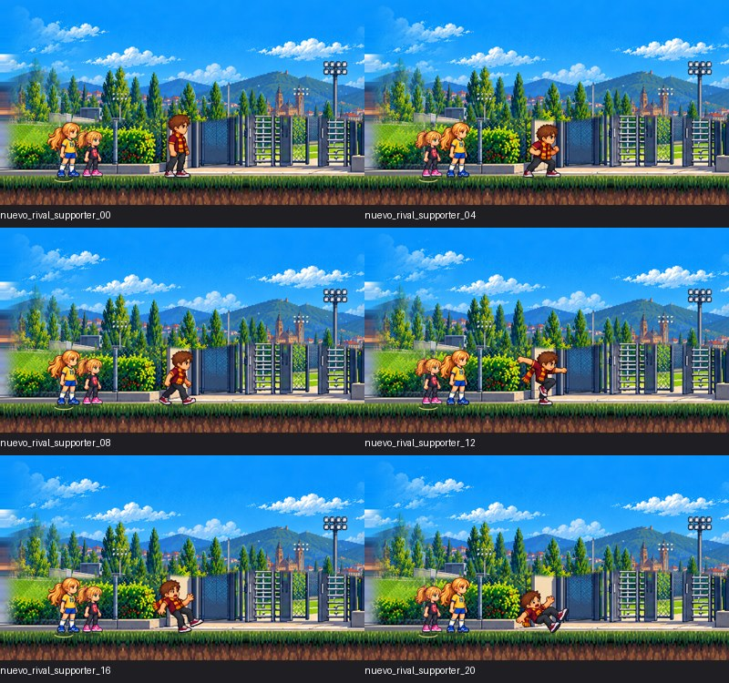
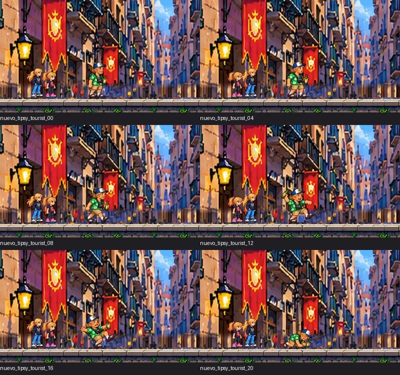
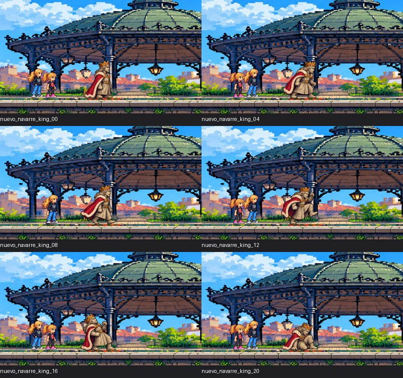
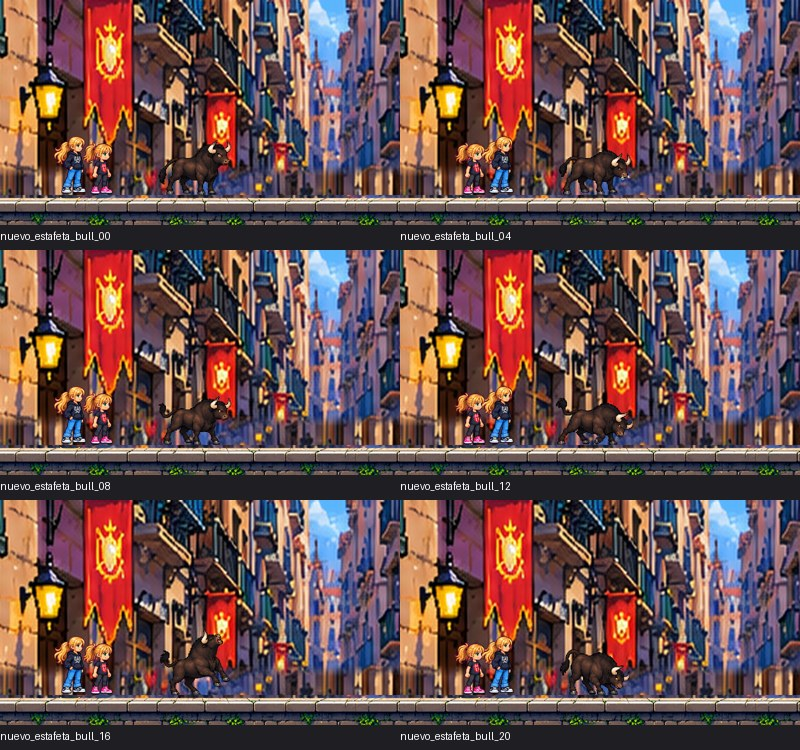
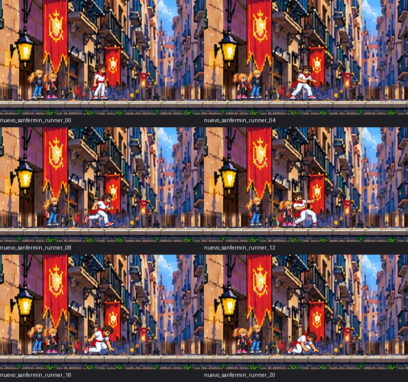
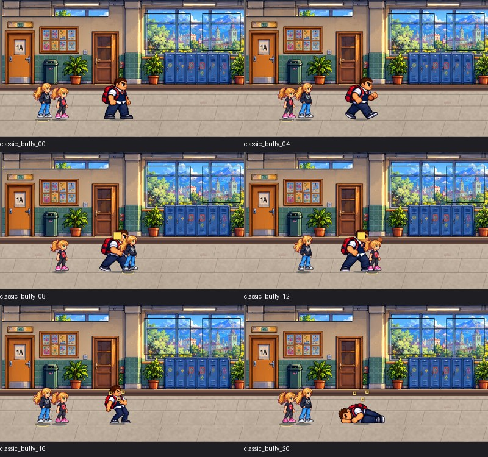
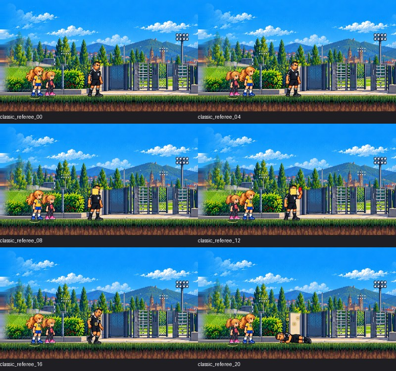
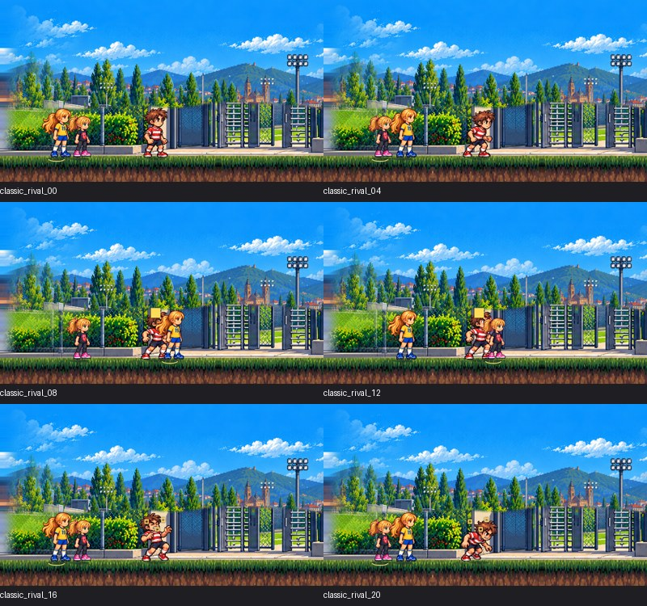
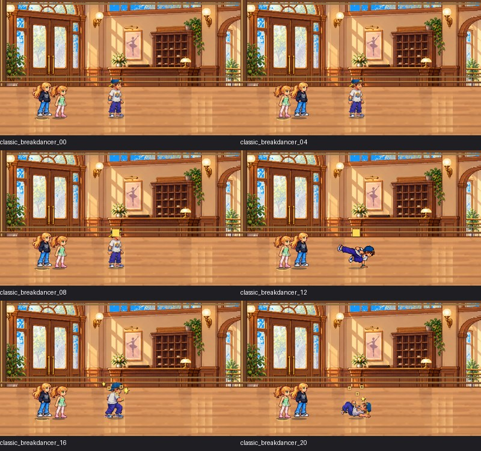

# Enemigos — entrega para revisión artística, 1 de noviembre de 2026

Rama `work/revision-visual-20261028-continuidad`. Código y recursos integrados; la aprobación artística final corresponde al usuario. No se genera APK ni se fusiona/publica en esta orden.

## Referencia aprobada → recurso integrado → motor

| Personaje | Referencia vinculante | PNG integrado | Animación del motor |
|---|---|---|---|
| Robot | [Maestro](../enemy_art_20261031/robot_master.png) · [Hoja](../enemy_art_20261031/robot_sheet_candidate.png) | [Atlas](../../assets/images/enemies_new/robot_atlas.png) | [WebP sin pérdida](nuevo_cleaning_robot.webp) |
| Corredor | [Hoja aprobada](../enemy_art_20261031/runner_sheet_candidate.png) | [Atlas](../../assets/images/enemies_new/sanfermin_runner_atlas.png) | [WebP sin pérdida](nuevo_sanfermin_runner.webp) |

## Evidencia de los diez enemigos

Los JPG son hojas de contacto de capturas auténticas del StagePainter. Las animaciones WebP sin pérdida proceden de 24 muestras renderizadas por enemigo: reposo, alerta/anticipación, movimiento, ataque, impacto y derrota, cuatro muestras por estado. Son secuencias controladas del motor, **no grabaciones de una partida ni capturas Android**. La versión WebP conserva los píxeles RGB del motor. Los GIF son vistas comprimidas secundarias y pueden alterar colores; no deben usarse para valorar la paleta. El codificador puede agrupar muestras idénticas conservando su duración. Los símbolos de texto de los tests pueden diferir de la fuente del dispositivo; revisar los sprites por separado de esos indicadores.

| Enemigo | Resultado | Capturas | Animación |
|---|---|---|---|
| Robot de limpieza | Dirección aprobada; render y animación para aprobación final | [JPG](nuevo_cleaning_robot.jpg) | [WebP](nuevo_cleaning_robot.webp) |
| Aficionado rival | Candidato ilustrado integrado | [JPG](nuevo_rival_supporter.jpg) | [WebP](nuevo_rival_supporter.webp) |
| Turista | Candidato ilustrado integrado | [JPG](nuevo_tipsy_tourist.jpg) | [WebP](nuevo_tipsy_tourist.webp) |
| Rey de Navarra | Marcha y reloj de ataque corregidos | [JPG](nuevo_navarre_king.jpg) | [WebP](nuevo_navarre_king.webp) |
| Toro de Estafeta | Cuatro fases de arranque completas | [JPG](nuevo_estafeta_bull.jpg) | [WebP](nuevo_estafeta_bull.webp) |
| Corredor sanferminero | Dirección aprobada; render y animación para aprobación final | [JPG](nuevo_sanfermin_runner.jpg) | [WebP](nuevo_sanfermin_runner.webp) |
| Matón | Cabeza/pies completos; impacto propio | [JPG](classic_bully.jpg) | [WebP](classic_bully.webp) |
| Árbitro | Uniforme y poses completas | [JPG](classic_referee.jpg) | [WebP](classic_referee.webp) |
| Jugador rival | Derrota original tumbado, frame 5 | [JPG](classic_rival.jpg) | [WebP](classic_rival.webp) |
| Bailarín | Tres transiciones dibujadas con apoyo | [JPG](classic_breakdancer.jpg) | [WebP](classic_breakdancer.webp) |

## Verificación técnica

La prueba `enemy_gameplay_integration_test.dart` ejecuta el ticker real para cada uno de los diez enemigos con ambas protagonistas. Comprueba anticipación, daño efectivo, evasión durante aviso, impacto de balón/peine, interrupción y ausencia de movimiento/daño tras la derrota. Se complementa con pruebas de lógica, hitboxes, poses, integridad de recursos y análisis Flutter. La prueba inyecta encuentros controlados; no equivale a una partida completa en móvil.

Los seis atlas nuevos están en producción; sus generadores instalan arte ilustrado protegido, sin sustitución procedimental. `enemyArtValidated` sigue falso hasta aprobación final; el modo `TWC_GAMEPLAY_PLAYTEST` permite la revisión jugable separada de esa aprobación. No se modifica aquí ninguna decisión de distribución o compilación de otros chats.

## Conocimiento y trazabilidad

- [Revisión y métodos](../enemy_art_20261031/REVIEW.md)
- [Tres poses nuevas del bailarín](../enemy_art_20261031/BREAKDANCER_REVISION.md)
- [Hashes protegidos](../enemy_art_20261031/locked_asset_hashes.json)
- [Método reutilizable para futuros juegos SNES](../../docs/FRAMEWORK_SNES_TWC/05_ENEMIGOS_ILUSTRADOS_Y_COMBATE.md)

## Resultado final de pruebas

[41317694621 — SUCCESS](https://github.com/Creadordevida/Hermanas-Pixel/actions/runs/41317694621). Fuente `ab5a640186d4281ee4085b11ea5b5944309e8735`; evidencia `8433cbd701120bdf2f60e316bd3aa3ddc527db6a`. 21 PNG protegidos, veinte encuentros de combate y 240 muestras del motor. Revisadas las secuencias de los diez enemigos y comprobada la eliminación del fragmento vecino en el ataque del robot. Aprobación artística final pendiente.

## Hojas de contacto auténticas

### Robot de limpieza

[Ver animación sin pérdida](nuevo_cleaning_robot.webp)

### Aficionado rival

[Ver animación sin pérdida](nuevo_rival_supporter.webp)

### Turista

[Ver animación sin pérdida](nuevo_tipsy_tourist.webp)

### Rey de Navarra

[Ver animación sin pérdida](nuevo_navarre_king.webp)

### Toro de Estafeta

[Ver animación sin pérdida](nuevo_estafeta_bull.webp)

### Corredor sanferminero

[Ver animación sin pérdida](nuevo_sanfermin_runner.webp)

### Matón

[Ver animación sin pérdida](classic_bully.webp)

### Árbitro

[Ver animación sin pérdida](classic_referee.webp)

### Jugador rival

[Ver animación sin pérdida](classic_rival.webp)

### Bailarín

[Ver animación sin pérdida](classic_breakdancer.webp)

